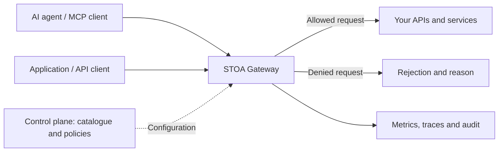
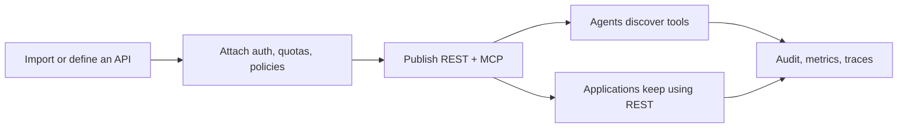
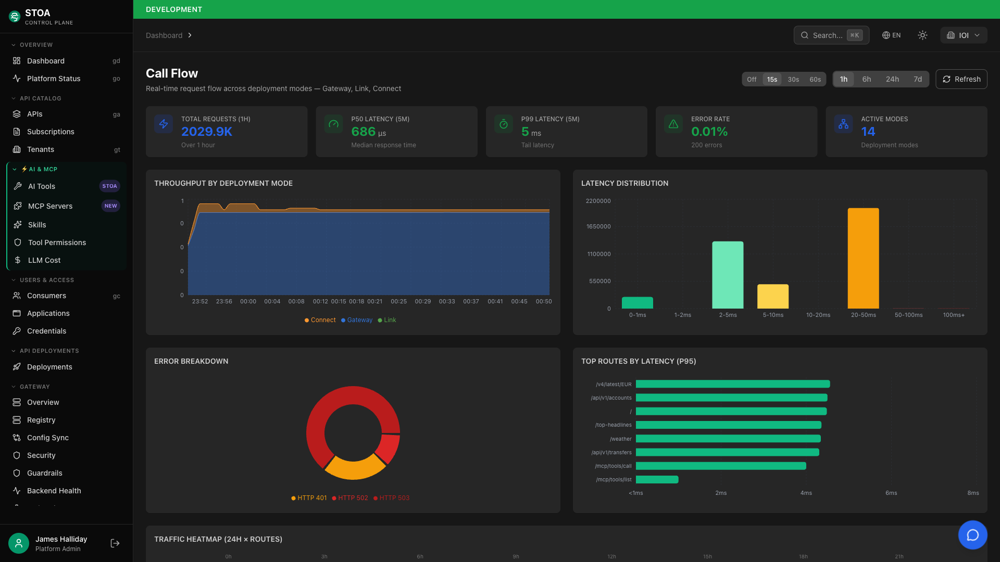
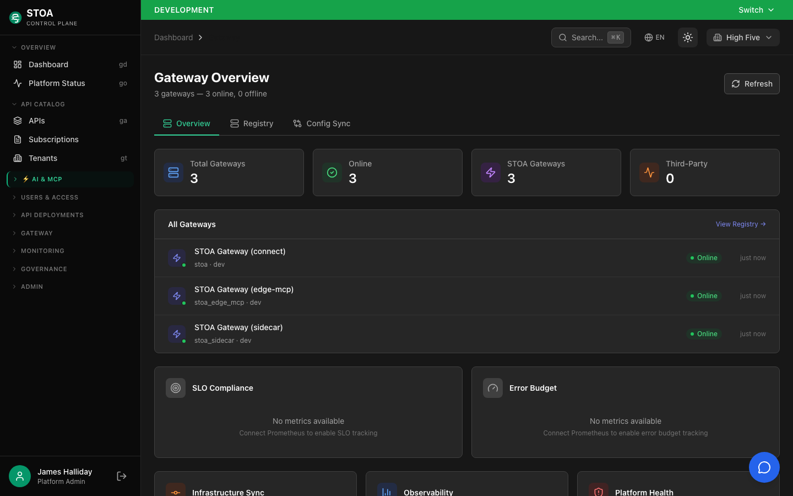

<p align="center">
  <strong>STOA</strong><br>
  <span>Open-source gateway for APIs and AI agents</span><br>
  <em>Your APIs. Your AI agents. Your control.</em>
</p>

<p align="center">
  <a href="LICENSE"></a>
  <a href="https://github.com/stoa-platform/stoa/actions/workflows/control-plane-api-ci.yml"></a>
  <a href="https://github.com/stoa-platform/stoa/stargazers"></a>
  <a href="https://discord.gostoa.dev"></a>
</p>

<p align="center">
  <a href="https://gostoa.dev">Website</a> ·
  <a href="https://docs.gostoa.dev">Docs</a> ·
  <a href="https://github.com/stoa-platform/stoa/discussions">Discussions</a> ·
  <a href="https://discord.gostoa.dev">Discord</a> ·
  <a href="SUPPORT.md">Support</a>
</p>

---

## Give agents API access. Keep control of the calls.

An AI assistant may need to look up an order, check an account or retrieve a document.
Giving it a broad API key makes access easy, but leaves platform teams with questions:
which API can it call, under whose identity, and why was a request allowed or denied?

**STOA is an open-source API gateway and control plane for applications and AI agents.**
It provides an MCP entry point to configured APIs, with identity, access policies
and visibility into calls passing through the gateway. Your existing services remain
the backends; you choose which routes to expose and which controls to apply.



## What STOA helps you do

| Your question | Where to start |
| --- | --- |
| How do I expose an API to an agent? | Describe the API and its MCP tools; connect a client to the gateway. |
| Who can call it? | Configure the caller identity and the route's access policies. |
| Why did a call fail? | Inspect the response, gateway metrics, traces and audit data. |
| How do developers find and request access? | Explore the catalogue and subscription flow in the Developer Portal. |
| How does it fit my current gateway? | Review the deployment modes and integration contract for your setup. |

**Start with a small, verifiable flow.** STOA is under active development; available
controls and integration steps depend on the deployment and route configuration.
The check below proves a specific authentication path, not every platform capability.

---

<a id="quick-start"></a>
<a id="access-control-quickstart"></a>

## Try an access-control check

The repository's [`quickstart/`](quickstart/README.md) runs STOA Gateway, the
control plane, Keycloak, PostgreSQL and a test backend. It checks three outcomes:

- No token → **401**.
- Invalid token → **401**.
- Valid Keycloak token → **200** from the test backend.

You need Bash, curl, openssl, Docker Engine and Docker Compose **2.1.1 or newer**.
Use a dedicated terminal. From a Linux host with GNU `timeout`:

```bash
git clone https://github.com/stoa-platform/stoa.git
cd stoa/quickstart

# Fresh credentials for this disposable local test; never print them.
set +x
export POSTGRES_PASSWORD="$(openssl rand -hex 32)"
export KC_BOOTSTRAP_ADMIN_PASSWORD="$(openssl rand -hex 32)"
export KEYCLOAK_CLIENT_SECRET="$(openssl rand -hex 32)"
export KEYCLOAK_ADMIN_CLIENT_SECRET="$(openssl rand -hex 32)"
export STOA_ADMIN_API_TOKEN="$(openssl rand -hex 32)"

docker compose config --quiet
timeout 300 docker compose up --build --wait
./verify.sh
```

On macOS, use `gtimeout` or the Perl alternative in the
[quickstart prerequisites](quickstart/README.md#prerequisites).
Keep that terminal open: Compose needs the same variables when you stop the local
test with `docker compose down`. Do not reuse these test credentials in production.

This flow declares the API directly through the gateway's `POST /admin/contracts`
with `inboundAuth`. The control-plane publication endpoint does **not** provide the
same JWT protection in this path. Read the
[current boundary](quickstart/README.md#r1-declaration-is-the-gateway-admin-api)
before extending it. The gateway is built from this checkout; host ports are bound
to `127.0.0.1`. This is an evaluation setup, not a production deployment.

## Explore the Console and Developer Portal

For a broader demo, follow the [full-stack guide](https://docs.gostoa.dev/docs/guides/quickstart).
It includes additional services and manual account setup, separate from the check above.

<details>
<summary>Full local demo setup</summary>

Run the full local stack with Docker Compose.

```bash
# Clone
git clone https://github.com/stoa-platform/stoa.git
cd stoa/deploy/docker-compose

# Start the demo stack
cp .env.example .env
# Set a strong KEYCLOAK_ADMIN_PASSWORD in .env before continuing
docker compose up -d

# Wait for services to become healthy
../../scripts/demo/check-health.sh --wait

```

After startup, sign in to the local Keycloak admin console with `KEYCLOAK_ADMIN` and
`KEYCLOAK_ADMIN_PASSWORD` from `.env`. For this local setup, create or select a user in
the imported application realm, assign the `cpi-admin` realm role, and set a strong,
non-temporary password. Add the matching username as `ANORAK_USER` and the chosen
password as `ANORAK_PASSWORD` to `.env`. These are the demo application credentials;
setting the variables alone does not configure the account.

Load the local configuration into the current shell, then seed demo data:

```bash
set -a
. ./.env
set +a
../../scripts/demo/seed-all.sh --skip-traffic
```

Open `http://localhost` and log in with:

The demo admin user configured in `ANORAK_USER`, with the password you set in
`ANORAK_PASSWORD` in your local `.env`.

| Service | URL |
| --- | --- |
| Console | `http://localhost` |
| Developer Portal | `http://localhost/portal` |
| API Docs | `http://localhost/api/docs` |
| Grafana | `http://localhost/grafana` |
| Keycloak | `http://localhost/auth` |
| Gateway health | `http://localhost/gateway/health` |

For local component-by-component development, see [`DEVELOPMENT.md`](DEVELOPMENT.md).

</details>

---

## From API definition to agent tool



1. **Describe the API** — import OpenAPI or use the Universal API Contract.
2. **Configure access** — attach the identity, policies and limits supported by your deployment.
3. **Expose and verify** — make the configured routes or MCP tools available, then test allowed and denied calls.

---

## How STOA fits your platform

### An API entry point for agents

The MCP interface lets agents discover and call configured tools. Platform teams
manage the routes, caller identity and policies applied by the gateway.

### Integrate with existing services

Use existing APIs as backends. The MCP entry point uses `edge-mcp` mode. The separate
`sidecar` mode provides an `/authz` decision endpoint for a host gateway; it does not
serve `/mcp` and requires host-side integration. See the
[sidecar contract and limitations](docs/integrations/sidecar-usage-patterns.md).

### Open source and self-hostable

The core platform is Apache 2.0. Run it locally, in Kubernetes, on-premise, or in a hybrid setup. Fork it, inspect it, extend it, or contribute back.

### Deployment under your control

Self-hosting lets you choose where the gateway and its supporting services run.
Your deployment, identity provider and operational controls determine data handling
and compliance; the software alone is not a certification.

---

## Architecture

```text
                         STOA Control Plane
        ┌──────────────────────────────────────────────────┐
        │ Console · Portal · Control Plane API · Keycloak  │
        │ Observability · Tenants · Subscriptions · Audit  │
        └───────────────────────┬──────────────────────────┘
                                │ sync
             ┌──────────────────┴──────────────────┐
             │                                     │
             ▼                                     ▼
┌──────────────────────────┐        ┌─────────────────────────────┐
│ STOA Gateway             │        │ Existing API Gateway         │
│ Rust · MCP · REST bridge │        │ Kong · Gravitee · Apigee     │
│ OAuth · mTLS · quotas    │        │ Azure APIM · AWS · webMethods│
│ Tool discovery · audit   │        │ Existing REST clients stay   │
└─────────────┬────────────┘        └──────────────┬──────────────┘
              │                                    │
              ▼                                    ▼
       AI agents via MCP                    Existing backends
```

**Deployment boundaries:** the gateway enforces policies on the routes configured
for it. The access-control quickstart above uses direct gateway declaration; a
healthy control plane alone does not prove a route is protected.

---

<a id="platform-capabilities"></a>

## Platform building blocks

| Capability | What it gives you |
| --- | --- |
| **MCP Gateway** | Governed tool discovery and execution for AI agents |
| **Universal API Contract** | One definition for REST and MCP exposure |
| **Self-Service Portal** | API discovery, subscriptions, credentials, and testing |
| **Admin Console** | Tenants, consumers, APIs, plans, subscriptions, and policies |
| **Gateway integrations** | Adapter code and contracts for supported gateways; deployment-specific setup is required |
| **Identity** | OIDC integration with Keycloak; upstream federation is configured in the identity provider |
| **Security Controls** | OAuth 2.1, PKCE, mTLS, JWT validation, RBAC, quotas, and per-consumer rate limiting |
| **Observability** | Prometheus metrics, Grafana dashboards, Loki logs, OpenSearch error snapshots, traces, and audit history |
| **Kubernetes resources** | Gateway Helm chart, operator code and CRDs; see deployment coverage below |

---

## Demo scenarios

After seeding the demo stack, try these flows:

| Scenario | What to look for |
| --- | --- |
| **Developer discovers an API** | Open the Portal, browse the API catalog, inspect specs, and request access |
| **Admin approves and governs access** | Use the Console to manage consumers, plans, subscriptions, tenants, and quotas |
| **Agent calls an API as a tool** | Observe how MCP traffic is authenticated, rate-limited, traced, and audited |
| **Platform team monitors usage** | Open Grafana and inspect latency, request rate, errors, quotas, and gateway health |

<details>
<summary>Console screenshots</summary>

<p align="center">
  
</p>

<p align="center">
  
</p>

</details>

---

## Who is STOA for?

**Platform teams** who already run API gateways and want an AI agent layer without replacing their infrastructure.

**Integration teams** modernizing legacy REST, SOAP, and webMethods APIs for agentic workflows.

**AI teams** connecting agents to APIs with explicit identity, access and observation requirements.

**Open-source builders** who believe the agentic web needs inspectable, self-hostable, standards-based infrastructure.

---

## Under the hood

| Component | Stack | Purpose |
| --- | --- | --- |
| Control Plane API | Python, FastAPI, SQLAlchemy | Backend API, RBAC, adapters, tenants, subscriptions |
| Console UI | React, TypeScript, Vite | Admin experience for platform teams |
| Developer Portal | React, TypeScript, Vite | Self-service API discovery and onboarding |
| STOA Gateway | Rust, Tokio, axum | API proxy, MCP bridge, auth, quotas, audit |
| `stoactl` | Go, Cobra | CLI and GitOps-style operations |
| Keycloak | OIDC, SAML, LDAP | Identity, federation, realms, authentication |
| Kubernetes Operator | Python, Kopf | CRD controller for MCP resources |
| Helm Chart | Helm 3 | Kubernetes gateway installation and supporting resources |

---

## Quality and security

The repository includes the checks below. Passing checks qualify the code and
scenarios they exercise; they do not establish universal security or compliance.

| Area | Practice |
| --- | --- |
| Gateway tests | Unit, contract, integration, and security tests |
| Control plane tests | Async API tests with coverage threshold |
| E2E tests | Playwright + BDD feature files for smoke, critical, portal, console, and gateway flows |
| Supply chain | SAST, dependency scanning, container scanning, SBOM generation, signed commits, and regression guards |

See [`SECURITY.md`](SECURITY.md), [`CONTRIBUTING.md`](CONTRIBUTING.md), and [`docs/`](docs/) for details.

---

## Deploying STOA

### Docker Compose

Use the [access-control check](#try-an-access-control-check)
for a small test, or the full local demo above for the Console and Portal.
Review the configuration and account setup before starting either stack.

See [`deploy/docker-compose/README.md`](deploy/docker-compose/README.md).

### Kubernetes

The Helm chart currently installs the Rust STOA Gateway and supporting resources.
The Control Plane API, console, Developer Portal, Keycloak and data services are
**not yet provided by the chart**. Prepare `my-values.yaml` using the
[gateway installation guide](docs/installation.md#configure-values).

```bash
helm install stoa-platform ./charts/stoa-platform \
  -n stoa-system --create-namespace \
  -f my-values.yaml
```

See the [installation guide](docs/installation.md) for the chart inventory,
external prerequisites and gateway checks.

---

## Repository map

```text
stoa/
├── control-plane-api/       # FastAPI backend
├── control-plane-ui/        # React admin console
├── portal/                  # React developer portal
├── stoa-gateway/            # Rust gateway + MCP bridge
├── stoa-go/                 # Go CLI and connect agent
├── stoa-operator/           # Kubernetes operator
├── charts/                  # Helm chart and CRDs
├── deploy/docker-compose/   # Local quick start
├── e2e/                     # Playwright BDD tests
├── scripts/                 # Demo, seed, benchmarks
└── docs/                    # Runbooks, ADRs, methodology
```

---

## Contributing

STOA is early, open, and looking for builders who care about making AI-to-API traffic safe, observable, and self-hostable.

Great places to contribute:

- **Gateway adapters** — Kong, Gravitee, Apigee, Azure APIM, AWS API Gateway, webMethods, and more.
- **MCP examples** — agent clients, tool definitions, demo workflows, Claude/Cursor integrations.
- **Security hardening** — OAuth, mTLS, RBAC, policy evaluation, audit, threat modeling.
- **Observability** — dashboards, traces, error snapshots, benchmark scenarios.
- **Docs and tutorials** — quick starts, migration guides, architecture notes, real-world examples.
- **Developer experience** — `stoactl`, local setup, test ergonomics, CI, Helm values.

Start with [`CONTRIBUTING.md`](CONTRIBUTING.md), open an issue, or join the community on Discord.

<a href="https://github.com/stoa-platform/stoa/graphs/contributors">
  
</a>

---

## Documentation and community

| Resource | Link |
| --- | --- |
| Documentation | <https://docs.gostoa.dev> |
| Website | <https://gostoa.dev> |
| GitHub Discussions | <https://github.com/stoa-platform/stoa/discussions> |
| Discord | <https://discord.gostoa.dev> |
| Support | [`SUPPORT.md`](SUPPORT.md) |
| Planning notes | [`ROADMAP.md`](ROADMAP.md) — check its update date |
| Technical explorations | [STOA Labs](https://cab-ingenierie.com/labs/) |
| Consulting and support | [CAB Ingénierie](https://cab-ingenierie.com/) |

---

## Related repositories

| Repository | Purpose |
| --- | --- |
| [`stoa-docs`](https://github.com/stoa-platform/stoa-docs) | Documentation site, ADRs, guides, API reference |
| [`stoa-web`](https://github.com/stoa-platform/stoa-web) | Public website |
| [`stoa-quickstart`](https://github.com/stoa-platform/stoa-quickstart) | Self-hosted quick start |
| [`stoactl`](https://github.com/stoa-platform/stoactl) | CLI for API management workflows |

---

## License

STOA is released under the [Apache License 2.0](LICENSE).

<p align="center">
  <em>Built by <a href="https://cab-ingenierie.com">CAB Ingénierie</a> — Paris, France.</em>
</p>
