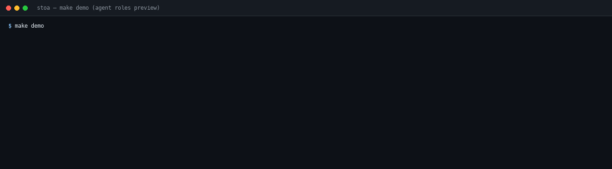

# STOA — keep your coding agents, take their API keys away

<p align="center">
  <a href="LICENSE"></a>
  <a href="https://github.com/stoa-platform/stoa/actions/workflows/ci-gate.yml"></a>
  <a href="https://github.com/stoa-platform/stoa/stargazers"></a>
  <a href="https://discord.gostoa.dev"></a>
</p>

<p align="center">
  <a href="docs/platform.md">Platform Overview</a> ·
  <a href="examples/agent-roles/README.md">Agent Roles Preview</a> ·
  <a href="stoa-go/README.md">stoactl CLI</a> ·
  <a href="DEVELOPMENT.md">Development</a> ·
  <a href="https://docs.gostoa.dev">Docs</a> ·
  <a href="SUPPORT.md">Support</a>
</p>

## The problem

Coding agents such as **Claude Code, Codex, Vibe, and Gemini CLI** commonly store
plaintext API keys in local config files and environment variables, with no
per-tool cap and no auditable decision trail when a call crosses a limit.

## How STOA solves it

- **Key-free agents (`preview`)** — keep provider and upstream API keys out of
  agent configs. `make demo` runs key-free agent containers while
  `stoa-gateway` injects the simulated backend credential
  (`caller_auth_headers_seen=0`); the gateway also includes Rust unit tests for
  the AES-256-GCM operator vault format (local `stoactl` vault commands are not
  yet shipped in `stoa-go/`).
- **Signed role with cap and auditable refusal (`preview`)** — Ed25519-signed
  roles enforce tool and argument caps (for example a `50 EUR` refund limit);
  over-limit calls are refused with a `decision_id` matched in the exported
  NDJSON journal (`decisions.ndjson`) and never reach the upstream service.
- **Local without an IdP, enterprise IdP ready** — evaluate agent roles locally
  with zero IdP or cloud account via `make demo`; for enterprise deployments,
  the same Rust gateway binary runs behind Keycloak / OIDC
  ([`quickstart/`](quickstart/README.md), [`docs/platform.md`](docs/platform.md)).

<p align="center">
  
</p>

## Try it (`preview`)

Requires Docker Engine, Docker Compose v2, `make`, `python3`, and `openssl`.
Runs an isolated local stack (simulated refund backend, zero IdP, no provider
API key required) and cleans up containers, volumes, and local images on exit:

```bash
git clone https://github.com/stoa-platform/stoa.git
cd stoa
make demo
```

**Measured on a fresh clone with no Docker or Go cache:** **1 command** inside
the clone (`make demo`; 3 commands including `git clone` and `cd`) and
**155.9 s** until the first refused call (`80 EUR` rejected at the `50 EUR` cap
with a journal-correlated `decision_id`, including the uncached Rust gateway
container build).

See [`examples/agent-roles/README.md`](examples/agent-roles/README.md) for the
step-by-step scenario and preview limits.

## Go further

| Area | Start here |
| --- | --- |
| Full platform (Control Plane, Portal, Console, Kubernetes, Helm) | [`docs/platform.md`](docs/platform.md) |
| Enterprise OIDC access-control check (Keycloak) | [`quickstart/README.md`](quickstart/README.md) |
| Official Go CLI (`stoactl`, single CLI for STOA) | [`stoa-go/README.md`](stoa-go/README.md) |
| Local development, tests, and linting | [`DEVELOPMENT.md`](DEVELOPMENT.md) |
| Contributing and security reporting | [`CONTRIBUTING.md`](CONTRIBUTING.md) · [`SECURITY.md`](SECURITY.md) |

## License

Released under the [Apache License 2.0](LICENSE).
